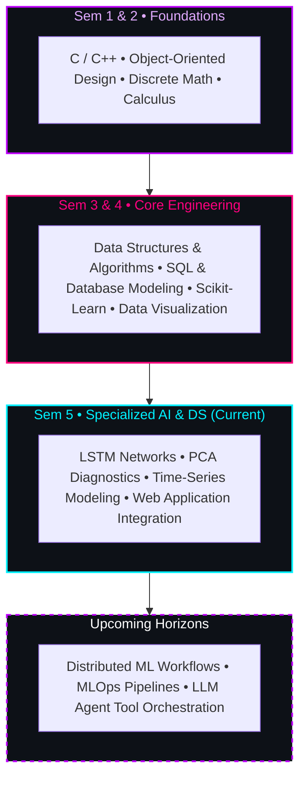

```mermaid
flowchart LR
    %% Synthwave Themed ML Architecture Diagram
    subgraph S1["📡 Sensor & Traffic Telemetry"]
        D1["Turbine Multi-Sensor Telemetry<br/>(Vibration, Temp, Speed)"]
        D2["WAN / Core Network Streams<br/>(Hourly & Daily Metrics)"]
    end

    subgraph S2["⚙️ Preprocessing & Regularization"]
        P1["Missing Value Imputation & Scaling"]
        P2["PCA Reconstruction Error<br/>(Dimensionality Regularization)"]
    end

    subgraph S3["🧠 Deep Learning Diagnostics"]
        M1["LSTM-RNN Sequence Model<br/>(Temporal Anomaly Detection)"]
        M2["Autoregressive Capacity Forecasting<br/>(Saturation Trend Horizon)"]
    end

    subgraph S4["🚀 Actionable Intelligence"]
        O1["Early Warning Failure Alerts"]
        O2["Interactive Vite/React UI<br/>& Capacity Planning Dashboards"]
    end

    S1 --> S2 --> S3 --> S4

    classDef darkBox fill:#0D1117,stroke:#BD00FF,stroke-width:2px,color:#00F0FF;
    classDef pinkBox fill:#0D1117,stroke:#FF007F,stroke-width:2px,color:#E0AAFF;
    classDef cyanBox fill:#0D1117,stroke:#00F0FF,stroke-width:2px,color:#FFFFFF;
    class S1 darkBox;
    class S2 pinkBox;
    class S3 darkBox;
    class S4 cyanBox;
```

  <!-- ==================== SYNTHWAVE / COSMIC HEADER BANNER ==================== -->
  

  <!-- ==================== ANIMATED TYPING SVG ==================== -->
  

  

    <i>B.Tech in Artificial Intelligence & Data Science • Architecting predictive telemetry pipelines, deep neural networks, and algorithmic tools.</i>
  

  <!-- ==================== STATUS & TELEMETRY BADGES ==================== -->
  

    
    
    
  

  <!-- ==================== NEON LASER DIVIDER ==================== -->
  

 

<!-- ==================== FLIGHT LOG // ABOUT ME ==================== -->
<table>
  <tr>
    <td width="62%" valign="top">
      <h3>📡 INCOMING TRANSMISSION // FLIGHT LOG</h3>
      

        Greetings, explorer! 👨‍💻 I'm <b>Sahil Whaval</b>, a 5th-semester <b>Artificial Intelligence & Data Science</b> undergraduate engineer. I bridge analytical data research with production-grade software engineering — transforming multi-sensor streams and high-dimensional graphs into actionable machine intelligence.
      

      <ul>
        <li>🎓 <b>Academic Track:</b> B.Tech in Artificial Intelligence & Data Science (Semester 5).</li>
        <li>🔬 <b>Active Research & Development:</b> Industrial telemetry diagnostics (PCA + LSTM-RNN), predictive traffic forecasting, and autonomous Gemini-powered agents.</li>
        <li>⚡ <b>Core Competencies:</b> Predictive Modeling, Anomaly Detection, Time-Series Forecasting, Algorithm Design, and Full-Stack Integration.</li>
        <li>💡 <b>Engineering Philosophy:</b> Rigorous mathematical foundations paired with modular, measurable implementations.</li>
        <li>💬 <b>Let's Discuss:</b> Neural architectures, PCA error regularization, graph heuristics, and synthwave lo-fi playlists.</li>
      </ul>
    </td>
    <td width="38%" align="center" valign="middle">
      
    </td>
  </tr>
</table>

 

<!-- ==================== ARCHITECTURE FLOW (MERMAID) ==================== -->

  
  <h2>🧬 PREDICTIVE PIPELINE & ARCHITECTURE SCHEMATIC</h2>
  
<i>End-to-end data flow powering industrial telemetry diagnostics and network capacity forecasting</i>

 

<!-- ==================== LEARNING ROADMAP (MERMAID) ==================== -->

  <h3>🗺️ ACADEMIC & TECHNICAL EVOLUTION</h3>

 

<!-- ==================== TECH ARSENAL / SKILL MATRIX ==================== -->

  
  <h2>⚡ TECH MATRIX & NEURAL ARSENAL</h2>
  
<i>Technologies and frameworks deployed across my academic and engineering repositories</i>

  
<b>Languages & Core Systems</b>

  

    
  

  
<b>AI, Machine Learning & Mathematical Computing</b>

  

    
  

  
<b>Backend, Databases & Developer Tooling</b>

  

    
  

<!-- ==================== SKILL SELF-ASSESSMENT PROGRESS ==================== -->

  
<i>Self-Assessment Proficiency (Academic & Project-Tested)</i>

  
  &nbsp;
  
   
  
  &nbsp;
  
  &nbsp;
  

 

<!-- ==================== FEATURED PROJECT EXPEDITIONS ==================== -->

  
  <h2>🚀 FEATURED PROJECT EXPEDITIONS</h2>
  
<i>Real open-source repositories driving intelligent telemetry, optimization, and automation</i>

  <table width="100%">
    <tr>
      <!-- PROJECT 1: Turbine Predictive Maintenance -->
      <td width="50%" valign="top">
        <h3 align="center">⚙️ Turbine Predictive Maintenance</h3>
        

          
        

        
<b>📖 Description:</b> Industrial IoT diagnostics application implementing an LSTM-RNN network regularized with PCA reconstruction error to isolate and forecast impending turbine component degradation.

        
<b>⚡ How it works:</b> Streams sensor observations into a PCA space to capture anomalous reconstruction variances, then feeds sequential temporal features into an LSTM-RNN to generate timely degradation alerts.

        

          
          
          
        

        <!-- Project Screenshot Slot (Drop your screenshot to assets/projects/turbine-preview.png) -->
        <!-- 

 -->
        

          
        

      </td>

      <!-- PROJECT 2: NetCapacity-AI -->
      <td width="50%" valign="top">
        <h3 align="center">🌐 NetCapacity-AI</h3>
        

          
        

        
<b>📖 Description:</b> End-to-end intelligent network capacity planning system that ingests historical WAN and campus edge telemetry to forecast traffic trends and pinpoint saturation thresholds.

        
<b>⚡ How it works:</b> Evaluates multi-frequency time-series datasets (`campus_core`, `datacenter_wan`) via dedicated ML engines, providing capacity planners with interactive forecasts and proactive alert triggers.

        

          
          
          
        

        <!-- Project Screenshot Slot (Drop your screenshot to assets/projects/netcapacity-preview.png) -->
        <!-- 

 -->
        

          
        

      </td>
    </tr>

    <tr>
      <!-- PROJECT 3: Shortest Path Visualizer -->
      <td width="50%" valign="top">
        <h3 align="center">🧭 Shortest Path Visualizer</h3>
        

          
        

        
<b>📖 Description:</b> Interactive browser-based algorithm workbench designed for Design and Analysis of Algorithms (DAA) coursework, exploring pathfinding dynamics on user-constructed graphs.

        
<b>⚡ How it works:</b> Visualizes five shortest-path algorithms step by step (including Dijkstra and A* Search) with zero dependencies, measuring runtime execution steps, node expansions, and queue updates.

        

          
          
          
        

        <!-- Project Screenshot Slot (Drop your screenshot to assets/projects/shortestpath-preview.png) -->
        <!-- 

 -->
        

          
        

      </td>

      <!-- PROJECT 4: DON v3.0 AI Assistant -->
      <td width="50%" valign="top">
        <h3 align="center">⚡ DON v3.0 AI Assistant</h3>
        

          
        

        
<b>📖 Description:</b> Cloud-powered personal assistant agent built in layered components, integrating Google Gemini LLM reasoning with real-time web querying and PC control automation.

        
<b>⚡ How it works:</b> Features an asynchronous brain module (`brain.py`), persistent contextual memory tracking (`memory.py`), tool dispatching, and a full-stack local server with web diagnostics.

        

          
          
          
        

        <!-- Project Screenshot Slot (Drop your screenshot to assets/projects/don-preview.png) -->
        <!-- 

 -->
        

          
        

      </td>
    </tr>
  </table>

  
<i>💡 Tip: To add real application previews, save PNG/GIF captures into <code>assets/projects/</code> and uncomment the corresponding image tags.</i>

 

<!-- ==================== GITHUB TELEMETRY & STATS ==================== -->

  
  <h2>📊 SYSTEM TELEMETRY & GITHUB SATELLITE</h2>
  
<i>Live satellite diagnostics tracking commit velocities, coding streaks, and linguistic distribution</i>

  <table border="0">
    <tr align="center">
      <td>
        
      </td>
      <td>
        
      </td>
    </tr>
    <tr align="center">
      <td colspan="2">
         
        
      </td>
    </tr>
  </table>

 

<!-- ==================== CONTRIBUTION SNAKE GAME ==================== -->

  
  <h2>🐍 THE SYNTHWAVE SNAKE EXPEDITION</h2>
  
<i>Automated serpent consuming contribution telemetry via GitHub Actions</i>

  <picture>
    <source media="(prefers-color-scheme: dark)" srcset="https://raw.githubusercontent.com/sahilwhaval99/sahilwhaval99/output/github-contribution-grid-snake-dark.svg" />
    <source media="(prefers-color-scheme: light)" srcset="https://raw.githubusercontent.com/sahilwhaval99/sahilwhaval99/output/github-contribution-grid-snake.svg" />
    
  </picture>

 

<!-- ==================== CURRENT ORBIT & PERSONALITY ==================== -->

  
  <h2>🪐 CURRENT ORBITS & EXPLORATION</h2>

<table>
  <tr>
    <td width="50%" valign="top">
      <h4>🔭 Currently Learning & Exploring</h4>
      <ul>
        <li>Deep dives into <b>Transformer Attention Mechanisms</b> & Sequence-to-Sequence Modeling.</li>
        <li><b>MLOps Foundations:</b> Containerizing models with Docker & managing reproducible pipelines.</li>
        <li>Advanced heuristic search optimization on high-density graphs.</li>
      </ul>
    </td>
    <td width="50%" valign="top">
      <h4>🛠️ Currently Architecting & Building</h4>
      <ul>
        <li>Refining two-stage <b>PCA reconstruction regularizers</b> on high-noise vibration telemetry.</li>
        <li>Improving time-series forecast accuracy in <b>NetCapacity-AI</b> for peak-hour network bursts.</li>
        <li>Experimenting with autonomous agent tool invocation patterns.</li>
      </ul>
    </td>
  </tr>
</table>

 

<!-- Collapsible Fun Facts -->

  
<b>👾 Click to decrypt engineering quirks & fun facts // [EXPAND]</b>

   
  <ul>
    <li>🎧 <b>Sonic Fuel:</b> 90% of my code is written with synthwave, darksynth, or 80s retro cyber radio humming in the background.</li>
    <li>⚡ <b>Favorite Mathematical Intuition:</b> Singular Value Decomposition (SVD) and PCA — turning unwieldy matrices into elegant principal vectors.</li>
    <li>🕹️ <b>Favorite Algorithm:</b> A* Search with admissible Euclidean heuristics — pure elegance in motion.</li>
    <li>☕ <b>Debugging Philosophy:</b> "If telemetry doesn't make sense, graph the raw variance before touching the loss function."</li>
  </ul>

 

<!-- ==================== DAILY CYBER QUOTE ==================== -->

  
  <h2>🔮 SYNAPSE ECHOES</h2>
   
  

 

<!-- ==================== WARP CHANNELS / CONNECT ==================== -->

  
  <h2>🌌 QUANTUM COMMS & COLLABORATION</h2>
  
<i>Looking for AI/Data Science internships, open-source initiatives, or machine learning research projects</i>

  <!-- GitHub Profile -->
  
  &nbsp;

  <!-- LinkedIn Badge with explicit TODO placeholder -->
  <!-- TODO: Update with your real LinkedIn profile URL once confirmed -->
  
  &nbsp;

  <!-- Direct Email -->
  
  &nbsp;

  <!-- Internship Availability Badge -->
  

    

  <!-- ==================== FOOTER WAVE ==================== -->
  

